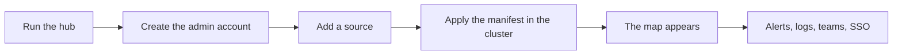
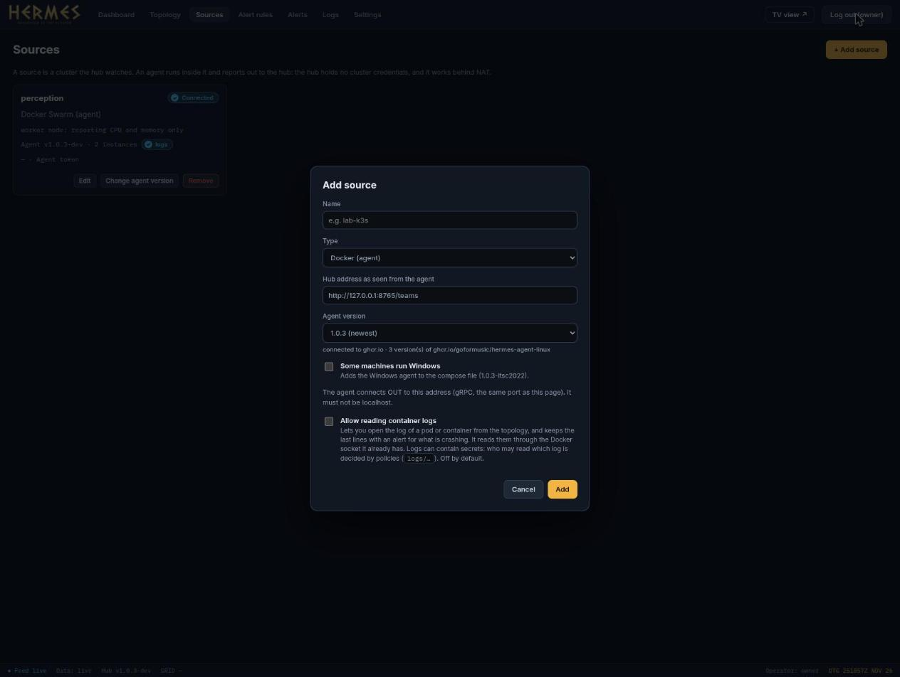
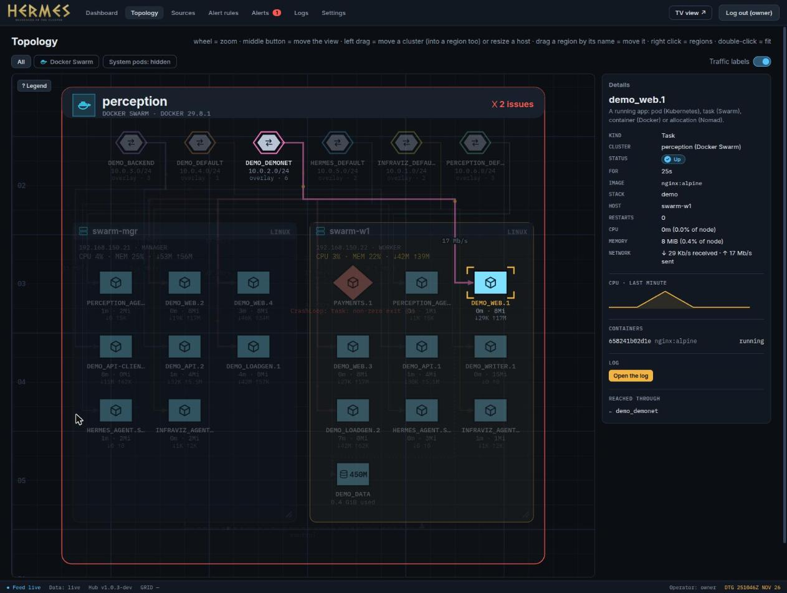

# How to start

From nothing to a live map in about ten minutes. You need Docker on one machine for the hub, and a cluster (Kubernetes or Docker Swarm) or any machine with Docker to watch.



## 1. Run the hub

The hub is one container: the web app, the API for the browser and gRPC for the agents, on one port. The database is a SQLite file in `/data`.

=== "Docker Compose (published image)"

    ```bash
    git clone https://github.com/GoForMusic/Hermes-cluster-vizualization.git
    cd Hermes-cluster-vizualization/hermes-server/deploy
    echo "HUB_SECRET_KEY=$(openssl rand -hex 32)" > .env     # encrypts what the hub stores; keep this file
    echo "HERMES_VERSION=1.1.0" >> .env
    docker compose -f docker-compose.yml -f docker-compose.image.yml up -d
    ```

    Open **http://localhost:8765**.

=== "Docker Compose (build it)"

    ```bash
    cd hermes-server/deploy
    echo "HUB_SECRET_KEY=$(openssl rand -hex 32)" > .env
    docker compose up -d --build
    ```

=== "Kubernetes (Helm)"

    ```bash
    helm install hermes ./deploy/helm/hermes -n hermes --create-namespace \
      --set ingress.enabled=true --set ingress.host=hermes.example.com
    ```

!!! warning "Keep `HUB_SECRET_KEY`"
    It encrypts the agent tokens, the registry password and the identity providers' secrets in the database. Lose it and the hub cannot read them. Back it up next to the data volume.

For a real installation (TLS, a domain, a sub-path behind Traefik) read [Install the hub](install/hub.md).

## 2. Create the admin account

The first visit asks for a username and a password (at least 10 characters). This account is the **break-glass** account: it always keeps its password and can do everything.

The checkbox *Allow the wallboard (TV) without login* decides whether `#/tv` can be opened by anyone who can reach the hub. Good on a trusted network; untick it otherwise. You can change it later in Settings.

!!! danger "Do this before the hub is reachable from the internet"
    Until the first account exists, anyone who opens the page creates it.

## 3. Add your first source

A **source** is one cluster. Go to **Sources → + Add source**:



| Field | What to put |
|---|---|
| Name | the cluster's name, for example `prod-eu` |
| Type | `Kubernetes (agent)`, `Docker Swarm (agent)` or `Docker (agent)` (a machine with Docker, no swarm) |
| Hub address as seen from the agent | where the **agent** reaches the hub, for example `https://hermes.example.com`. **Not** `localhost` |
| Allow reading container logs | tick it if you want the log panel (see [Logs](using/logs.md)) |

Press **Add**. The dialog shows a manifest with the agent's token. **It is shown once**: copy it.

## 4. Apply it in the cluster

=== "Kubernetes"

    ```bash
    # save the manifest as agent.yaml, then:
    kubectl apply -f agent.yaml
    kubectl -n hermes get pods          # 1/1 Running
    ```

    One read-only agent pod per cluster (a ServiceAccount that can only `get`, `list` and `watch`).

=== "Docker Swarm"

    On a **manager** node:

    ```bash
    # save it as agent.yml, then:
    docker stack deploy --with-registry-auth -c agent.yml hermes
    ```

    One agent per node (a global service): each reports its own node, and the manager's also reports the swarm.

=== "Docker (one machine)"

    ```bash
    # save it as agent.yml on the machine, then:
    docker compose -f agent.yml up -d
    ```

Within a few seconds the source turns **Connected** and the cluster appears in **Topology**.



## 5. Look around

- **Dashboard** lists every monitor with its uptime; click one for its history and events.
- **Topology** is the live map. Click a host, pod or volume for details. Wheel to zoom, middle button to move.
- **TV view ↗** is the wallboard for a screen in the room: [what it shows](using/interface.md#the-wallboard-tv).
- **Alerts** keeps every incident, open or resolved, as a report you can copy into a ticket.

## 6. Then

| | |
|---|---|
| People other than you | [Users, groups and policies](security/access.md) |
| A team that sees only its own cluster | [Teams](security/teams.md) |
| Sign in with the company account | [Single sign-on](security/sso.md) |
| Read a pod's log from the map | [Logs](using/logs.md) |
| Change the agents' version from the page | [Sources and agents](install/agents.md#changing-the-agents-version) |
| A second network the agents cannot reach | [Federation](install/federation.md) |
