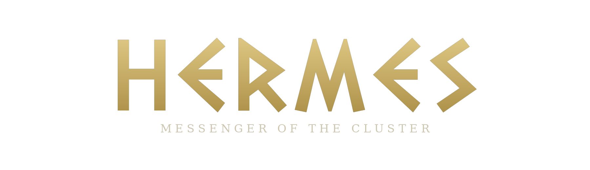
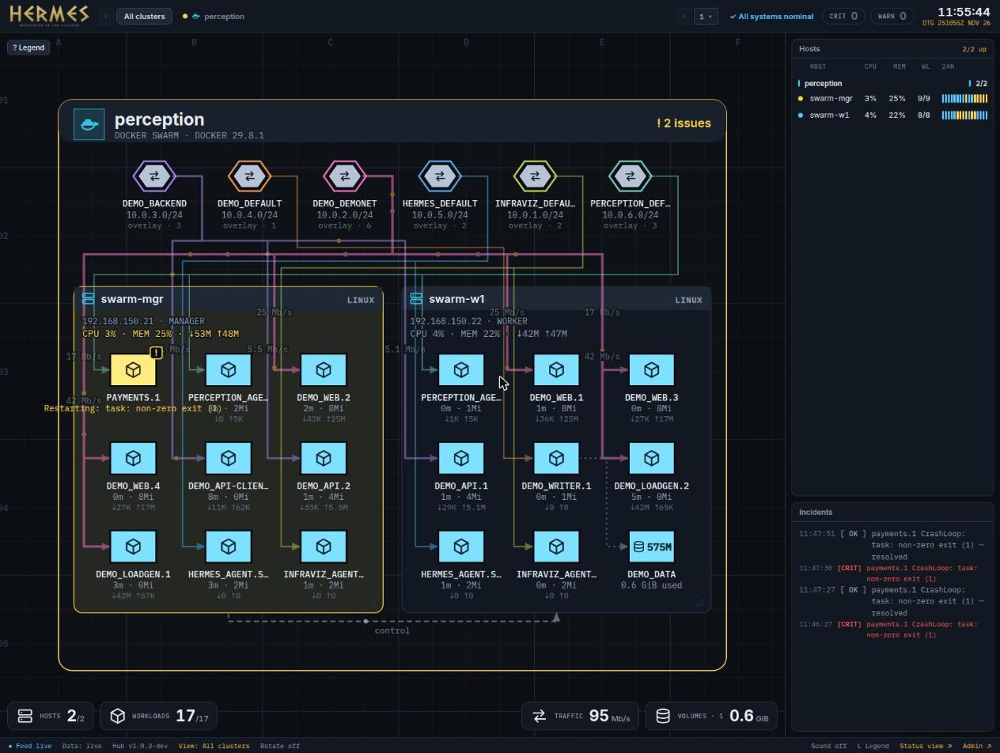
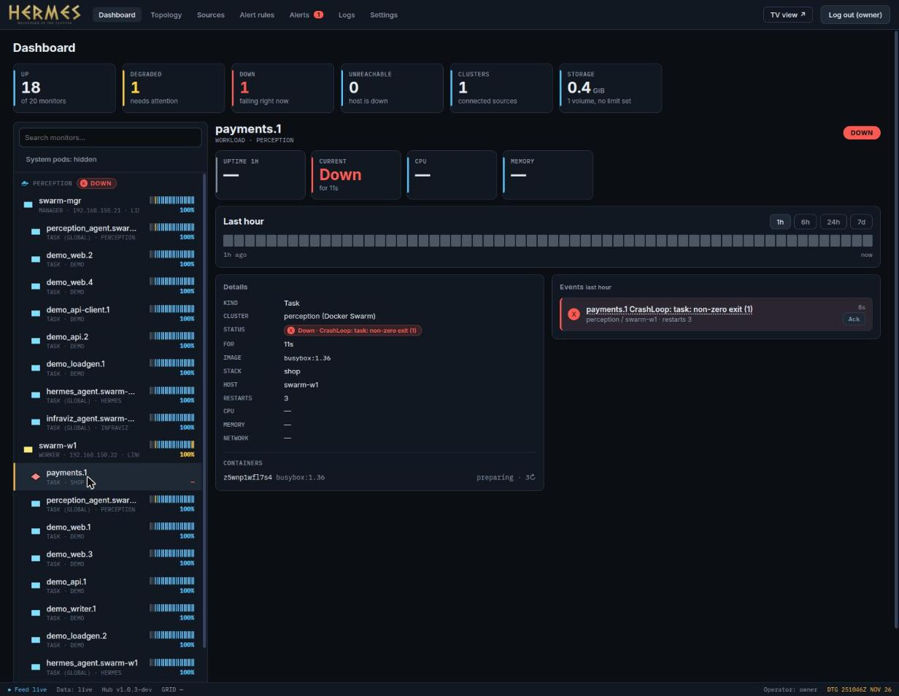

{ .hero-logo }

**A live map of your Kubernetes, Docker Swarm and Docker machines: what runs where, what is using what, and what just broke.**

[How to start](how-to-start.md){ .md-button .md-button--primary }
[Install the hub](install/hub.md){ .md-button }
[Read the API](reference/api.md){ .md-button }

HERMES is **one hub** and **small agents**. The agents run inside your clusters and report *out* to the hub (so it works behind NAT and holds no cluster
credentials); the hub draws the map, watches it, raises alerts, and serves a wallboard for the room and an admin panel for the people.

## What you get

-   :material-map-marker-radius: **A live map**

    Clusters, hosts, pods and tasks, volumes and networks, with real traffic between them. [The interface](using/interface.md)

-   :material-bell-alert: **Alerts that explain themselves**

    An incident report says what happened, since when, what else was down, and keeps the last lines of the container's log. [Alerts and incident reports](using/interface.md#alerts-and-incident-reports)

-   :material-text-box-search: **Container logs, in the page**

    Open the log of a pod, a task or a container from the map: follow it, search it, see what it said before it crashed. [Logs](using/logs.md)

-   :material-shield-account: **Users, groups and policies**

    Vault-style policies decide who sees which cluster and who may do what. A team sees only its own cluster. [Access](security/access.md), [Policies](security/policies.md)

-   :material-login: **Single sign-on**

    Microsoft Entra ID, Google, Keycloak, Okta: any OpenID Connect provider, with group mapping. [SSO](security/sso.md)

-   :material-lan-connect: **Several hubs, one view**

    A hub that manages another one, for networks where only one direction is open. [Federation](install/federation.md)

## Where to go next

| I want to... | Read |
|---|---|
| try it in ten minutes | [How to start](how-to-start.md) |
| run it for real (TLS, a sub-path, Kubernetes) | [Install the hub](install/hub.md) |
| connect a cluster | [Sources and agents](install/agents.md) |
| give people their own view | [Teams](security/teams.md) |
| sign in with my company account | [Single sign-on](security/sso.md) |
| call the API | [API reference](reference/api.md) |
| know every setting | [Configuration](reference/configuration.md) |
