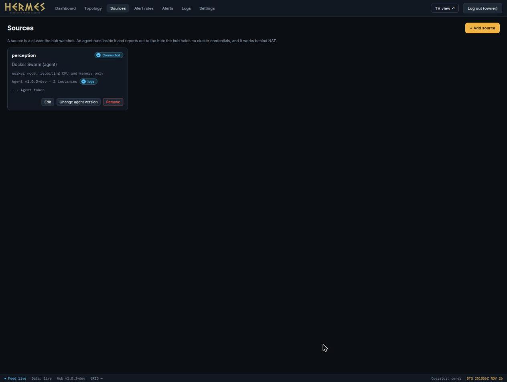

# Sources and agents

A **source** is one cluster the hub watches. An **agent** runs inside it and reports *out* to the hub over one long-lived gRPC stream: the hub holds no cluster credentials, and it works behind NAT.

## The agents

| Source type | What is installed | What it reads |
|---|---|---|
| `Kubernetes (agent)` | one **cluster reader** pod (Deployment) and, optionally, one **node agent** per node (DaemonSet) | the cluster API: nodes, pods, namespaces, volumes, Services, Ingresses, network policies, Gateway API routes; and the nodes' kubelet stats |
| `Docker Swarm (agent)` | a **global service**: one agent per node | the Docker API: a manager's agent reports the swarm (nodes, services, tasks, networks), every agent its own node's CPU and memory |
| `Docker (agent)` | a compose file for **one machine** | its containers, networks and volumes |
| Windows nodes | `hermes-agent-windows`, in a Swarm stack | CPU, memory and the containers of that node. See [the Windows note](#windows) |

The Kubernetes ClusterRole is `get`, `list`, `watch` only (plus `nodes/proxy` and `nodes/stats` `get` for the kubelet numbers). Nothing in a manifest can change your cluster. Two things are added **only if you ask for them**
when adding the source, each with exactly the rights it needs:

| Option | What the manifest adds |
|---|---|
| **Allow upgrades from the dashboard** | a Role that can `get` and `patch` the agent's own Deployment and DaemonSet, and nothing else |
| **Allow reading container logs** | `pods/log: get` and `LOGS=1` ([Logs](../using/logs.md)) |
| **Show who talks to whom** (Kubernetes) | the node agents run in the node's network and read the kernel's connection table (`nf_conntrack_acct=1` on the node) |

## Adding a source

1. **Sources → + Add source.** Name, type, and the address the **agent** uses to reach the hub (never `localhost`).
2. Copy the manifest it shows (the token is in it, **once**).
3. Apply it: `kubectl apply -f agent.yaml`, `docker stack deploy --with-registry-auth -c agent.yml hermes` on a swarm manager, or `docker compose -f agent.yml up -d`.
4. The source turns **Connected**. A cluster that is added twice (two sources, one cluster) shows the second one as **Duplicate**: the cluster is identified by its own UID, not by the name you typed.

The agents are told where the hub is with `HUB_URL`; every setting is in the [configuration reference](../reference/configuration.md).

## Where the agent images come from

**Settings → General → Registry.** The default is the public images on `ghcr.io/goformusic`. Point it at your own registry (Docker Hub, Harbor, Gitea, GHCR) with a login, press **Test connection**,
and the hub lists the versions it finds. *Add source* then offers them and writes the image, and the pull secret for Kubernetes, into the manifest. The registry password is stored encrypted.

## Changing the agents' version

On a source's card: **Change agent version**. The hub sends only the **version** over the agent's stream; the agent changes its own image (Kubernetes: the DaemonSet first, then its own Deployment, with a rollback if
the new pods are not healthy; Swarm: a start-first service update with rollback). It keeps its registry and repository, so a compromised hub cannot point it at another image.
The card shows *Changing to v…*, then *Now v…* or the reason it failed. An agent that is behind the newest version in the registry carries an *update → v…* mark.

Only sources added with *Allow upgrades from the dashboard* can do this; the others are updated by applying a new manifest.

## Windows

`hermes-agent-windows` runs on Windows nodes of a Swarm (`-ltsc2022`, `-ltsc2019`). It is built natively on a Windows runner. Kubernetes needs no Windows agent: the Linux reader sees the whole cluster, Windows nodes included.
Reading container logs is not available on Windows agents yet.

## Removing a source

**Remove** on the card. The hub forgets the source, its history and its alerts, and its agents are turned away within 30 seconds (their token stops working). Nothing is deleted in the cluster: remove the agent there yourself.
