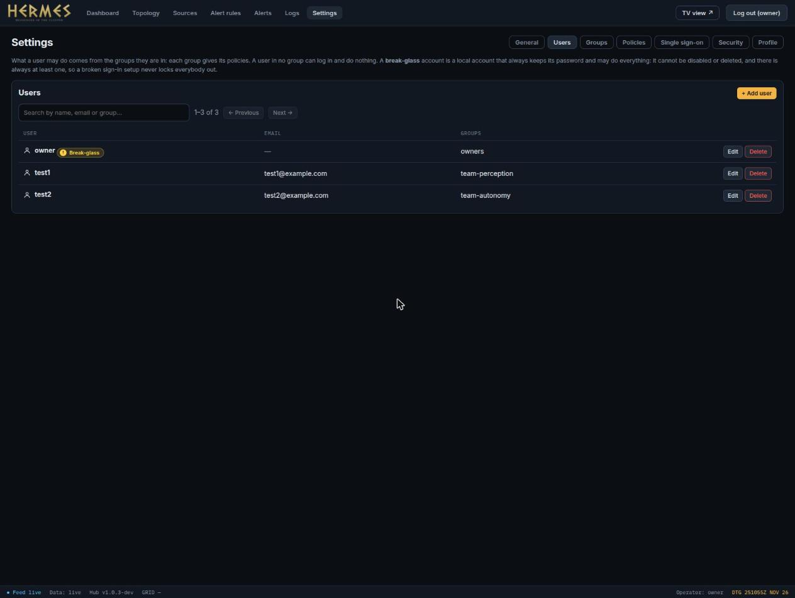
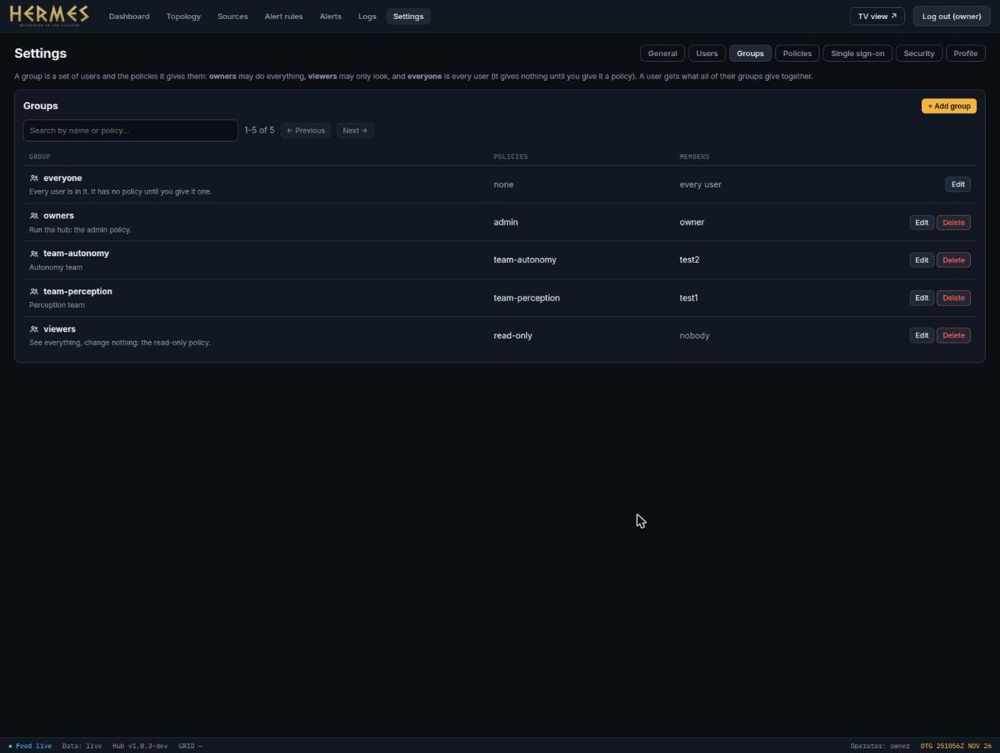
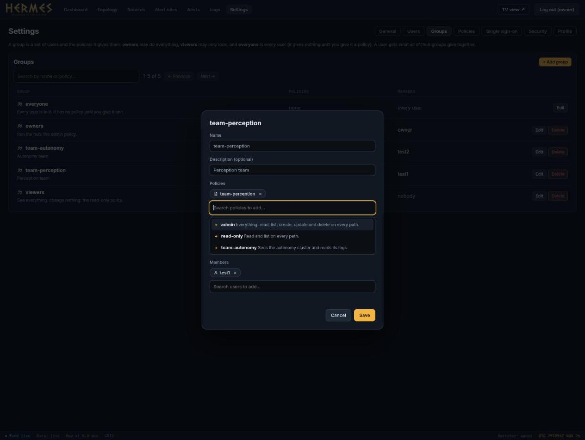
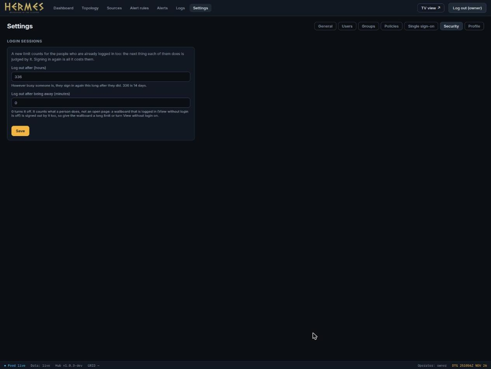

# Users, groups and policies

Access in HERMES is modelled on HashiCorp Vault: **users** belong to **groups**, groups carry **policies**, and a policy is a short text that says which API paths may be used and how. The admin panel is built on the same API, so the buttons a person sees are the calls they may make.

## Users

| Kind | |
|---|---|
| **Break-glass** | A local account with a password: the one created on first start, and any other you mark so. It always works, whatever the identity provider does, and can always sign in with its password. |
| **Local** | A person with a password, made in Settings → Users. |
| **SSO** | Created by the identity provider on first sign-in ([SSO](sso.md)). Has no password. |

A user can be turned off without deleting them (their sessions end).

## Groups

A group is a set of users and the policies it gives them. A user gets what **all** of their groups give together.

| Group | |
|---|---|
| `owners` | the `admin` policy: everything |
| `viewers` | the `read-only` policy: look, change nothing |
| `everyone` | every user is in it, and it gives **nothing** until you give it a policy |

The three exist on a new hub (and appear on an upgraded one) and can be edited; you can add as many groups as you like.

## Policies

[The policy language and every path](policies.md).

## Sessions

Two limits, both in **Settings → Security**:

- **Log out after (hours)**: a session ends this long after it started, however busy the person is. Default 336 (14 days).
- **Log out after being away (minutes)**: a session ends when its person does nothing for this long. `0` turns it off. It counts what a person *does*, not an open page: a logged-in wallboard is signed out by it too, so give it a long limit or turn *Allow the wallboard without login* on.

The new limit counts for people who are already logged in. A session that has ended also ends its live event stream.

## The first admin and the break-glass

The first account is created in the page (`/api/auth/setup`, once, only while there are no users). If an identity provider is set up wrong or is down, the break-glass users can still enter with their password. When a provider is on with *Passwords for break-glass accounts only*, nobody else may use a password.
