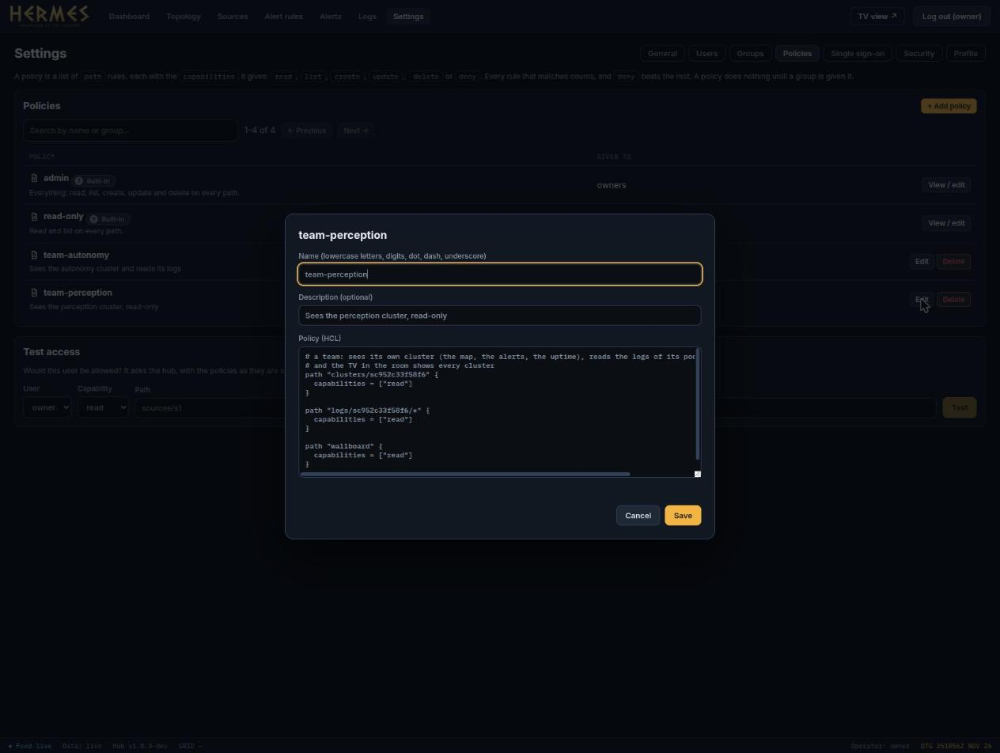

# Policies

A policy is written in the language of Vault's HCL: a list of `path` blocks, each with the **capabilities** it grants.

```hcl
# a team that sees its own cluster and reads its logs
path "clusters/9f2c1e" {
  capabilities = ["read"]
}
path "logs/9f2c1e/*" {
  capabilities = ["read"]
}
```



## How a call is judged

Every request to the API becomes two things:

1. a **capability** from the method: `GET` → `read` (and `list`, which is the same for a `GET`), `POST` → `create`, `PUT` and `PATCH` → `update`, `DELETE` → `delete`;
2. a **path**: the URL without `/api/`, for example `GET /api/sources` → `sources`, `DELETE /api/users/7` → `users/7`.

The rules:

- **No rule, no access.** A path nothing matches is refused.
- **A `deny` capability wins** over any allow, from any policy of any group.
- A path ending in `*` matches everything below it (`logs/*`); a `+` stands for exactly one segment (`logs/+/prod/*`). Otherwise the match is exact.
- The user's policies are all of their groups' policies, added up.

!!! tip "Try it before you save"
    The editor has a **Check** box: type a path and a capability and it says whether the policy being edited lets it through (`GET /api/policies/check`).

## Paths

| Path | What it covers |
|---|---|
| `clusters/<source id>` | **seeing** a cluster: its map, nodes, alerts and uptime. A source's id is in `GET /api/sources` (the `id` field) and in the agent's `SOURCE_ID`. |
| `logs/<source id>/<namespace>/<name>` | reading the log of a pod (Kubernetes) or `…/<service>` (Swarm/Docker) |
| `wallboard` | the TV view shows **every** cluster to the one who may read it |
| `sources`, `sources/<id>`, `sources/<id>/upgrade` | the Sources tab, adding, removing, changing the agents' version |
| `alerts/<id>/ack` | acknowledging an alert |
| `settings`, `registry`, `registry/…` | Settings → General and the registry |
| `comm-log`, `comm-log/<id>` | the hub ↔ agent communication log |
| `users`, `groups`, `policies`, `identity-providers`, `security` | Settings → Users, Groups, Policies, Single sign-on, Security |
| `federation`, `federation/…`, `dc/<id>/…` | other hubs, and what a person does in them |

Calls that only describe a person's own session (`/api/auth/*`, their own password) need a login and nothing more.

A user who has **no rule at all** and can see **no cluster** gets *403*; one who can see at least one cluster gets the map of those, and the page offers only what they may use (no Sources tab without `sources`, and so on).

## Recipes

**Read everything, change nothing**

```hcl
path "*" { capabilities = ["read", "list"] }
```

**The team of one cluster** (the typical *team A / team B* setup)

```hcl
path "clusters/<source id>" { capabilities = ["read"] }
path "logs/<source id>/*"   { capabilities = ["read"] }
```

Put it in a policy, the policy in a group (`team-a`), the people in the group, and give `everyone` no policy. Each person sees only that cluster in Dashboard, Topology and Alerts; Sources, Alert rules and the communication log are not offered; Settings shows only Profile.
The TV view of the same person still shows every cluster if you also give them `path "wallboard" { capabilities = ["read"] }`.

**Everything except the logs**

```hcl
path "*"      { capabilities = ["read", "list", "create", "update", "delete"] }
path "logs/*" { capabilities = ["deny"] }
```

**Someone who runs the alerts but nothing else**

```hcl
path "clusters/*"   { capabilities = ["read"] }
path "alerts/+/ack" { capabilities = ["create"] }
```
