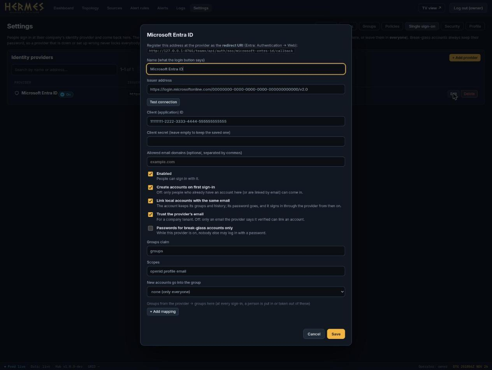
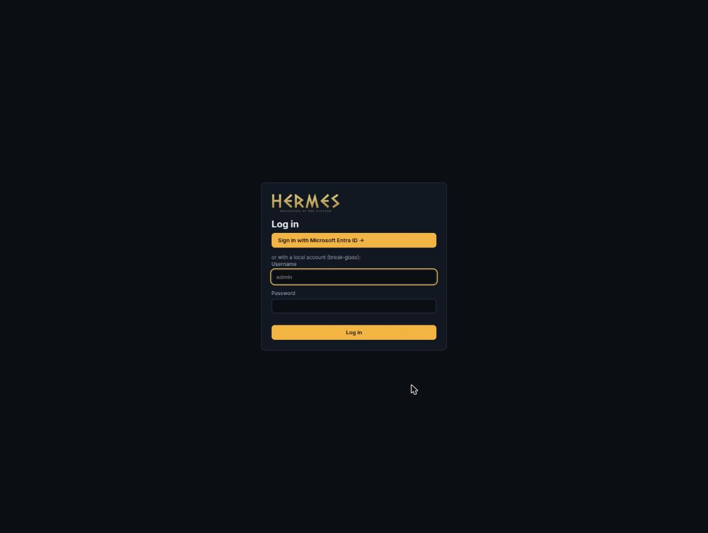

# Single sign-on

People can sign in at the identity provider of their company (OpenID Connect: Microsoft Entra ID, Google, Keycloak, Okta, ...) instead of with a password.
Settings → Single sign-on. The provider says **who** a person is; **what** they may do is decided here, by the policies of the groups they are in
([Users, groups and policies](access.md)).

## Microsoft Entra ID

1. In the Azure portal: Microsoft Entra ID → App registrations → New registration. Platform **Web**, redirect URI: the one the hub shows when you save the provider
   (`https://<hub>/api/auth/sso/<id>/callback`; with a base path, `https://<host>/hermes/api/auth/sso/<id>/callback`). It must be exactly that.
2. Certificates & secrets → New client secret. Copy the **value**.
3. In the hub: Add provider → *Fill in for Microsoft Entra ID*, put your **tenant id** in the issuer
   (`https://login.microsoftonline.com/<tenant id>/v2.0`; `common` and `organizations` do not work: the issuer in the token must be the one in the address),
   the application (client) id, the secret. *Test connection* reads the provider's discovery document.
4. Groups: Token configuration → Add groups claim (Security groups → "Group ID"). The claim then holds the group's **object id**: map each id to a group here.
   A user who is in more than about 200 groups gets no groups claim at all (Entra sends a link instead): their groups here are then left as they are.

Google (`https://accounts.google.com`), Keycloak (`https://<host>/realms/<realm>`) and Okta work the same way. GitHub is OAuth2 and not OpenID Connect: not supported.

## What a sign-in does

- A person with a provider's `sub` already has an account: they are in. Otherwise, if *Link local accounts with the same email* is on and the provider
  vouches for the address (`email_verified`, or *Trust the provider's email*), the local account with that email becomes theirs: same account, same groups, and what
  it acknowledged keeps its name; its password goes. Otherwise, if *Create accounts on first sign-in* is on, a new account is made. Break-glass accounts are never taken over.
- *Allowed email domains* limits who may come in. *New accounts go into the group* gives them something to start with; without it they are only in `everyone`
  (which gives nothing until you give it a policy).
- *Groups from the provider → groups here*: at **every** sign-in, a person is put in or taken out of the mapped groups to match the claim. Groups that are not
  mapped are not touched, and a token with no groups claim at all changes nothing.
- A person who leaves the company is out at their next sign-in at the provider, but stays logged in here until their login ends: use Settings → Security to set how long
  that is, and disable the account here to end it at once.
- *Passwords for break-glass accounts only* makes the provider the only way in for everyone but the break-glass accounts.

## Safety

Authorization code with PKCE; the id token's signature, issuer, audience, expiry and nonce are checked; the browser that comes back must be the one that left
(a cookie bound to the sign-in); a sign-in can be completed once and within ten minutes. Client secrets are encrypted in the database like the registry's.
The hub's address for the callback is `HUB_PUBLIC_URL` when set, otherwise built from the request (behind a proxy: `X-Forwarded-Proto` and `X-Forwarded-Host`).
