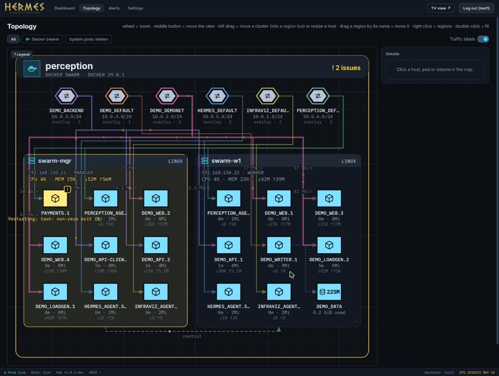

# Teams: each sees only its own cluster

A common setup: two teams, two clusters, nobody sees the other's.

1. **Add each cluster as a source** and note its id (`GET /api/sources`, or `SOURCE_ID` in the manifest).
2. **Write a policy per team** that reads `clusters/<id>` and `logs/<id>/*` ([recipe](policies.md#recipes)).
3. **Make a group per team** and give it that policy.
4. **Put the people in it**: local users by hand, SSO users [by mapping the provider's groups](sso.md#what-a-sign-in-does) so it follows the company directory.
5. **Leave `everyone` without a policy**, so nobody sees anything by default.

What the team member gets:

| | |
|---|---|
| Dashboard, Topology, Alerts | only their cluster's monitors, nodes and alerts |
| Logs | the logs under their `logs/<id>/…`; elsewhere the button says what is missing |
| TV view | every cluster if they also read `wallboard`, else only theirs |
| Sources, Alert rules, communication log | not offered |
| Settings | only **Profile** |

The filtering is on the **server**: the event stream, the alerts and the uptime are cut before they leave the hub, not hidden in the page.
