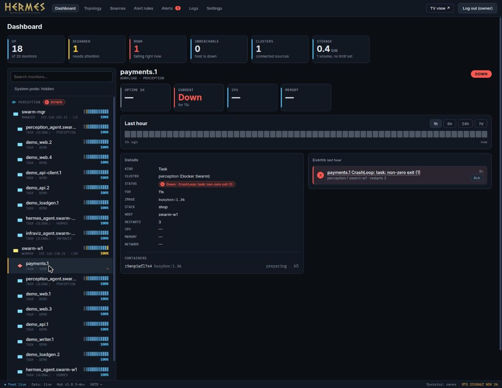
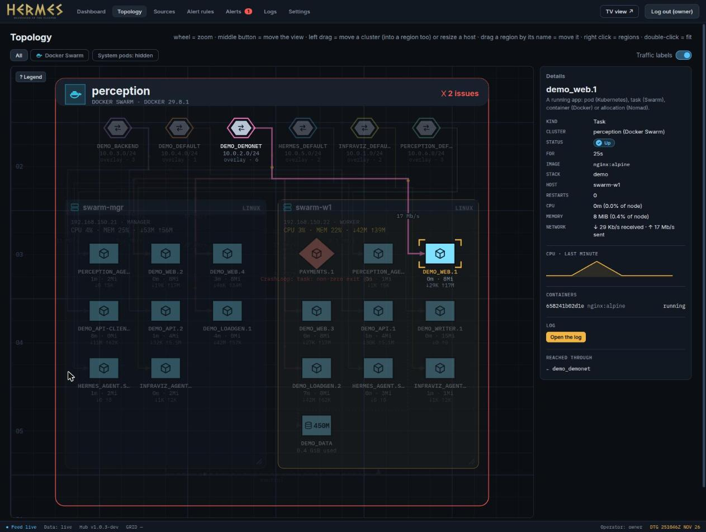
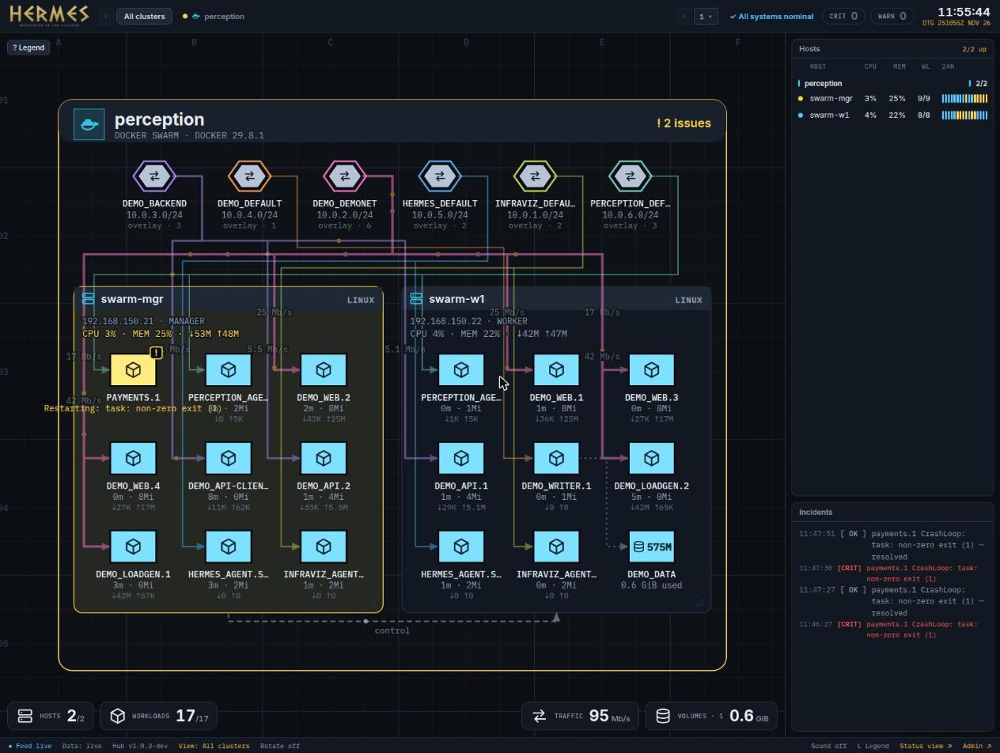
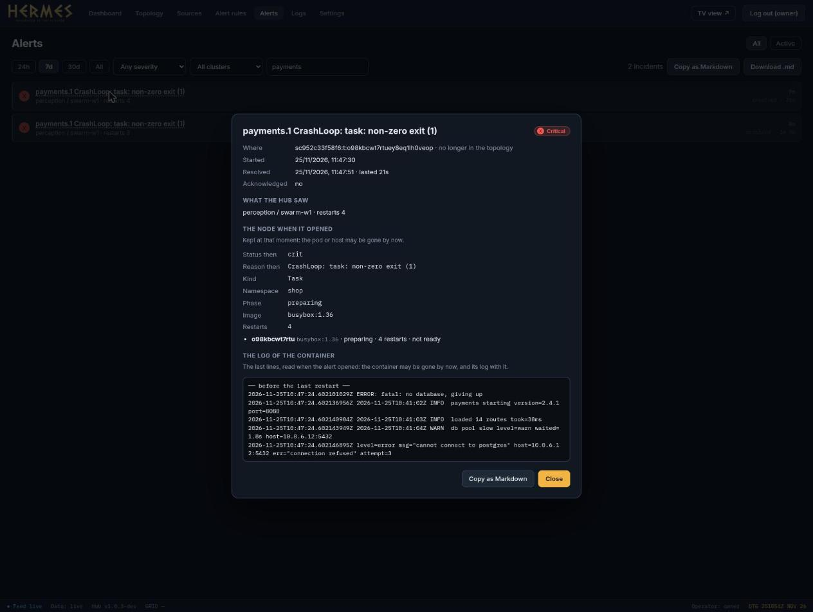

# The interface

HERMES has two faces: the **wallboard** (TV) for a screen in the room, and the **admin panel** for people. Both read the same live state.

## Dashboard

Every host and workload is a monitor with a bar of its recent state and its uptime. Click one for its history and events.

## Topology

The live map. Each source is a frame; inside it, hosts with their pods or tasks, volumes, and the networks that connect them. Lines are real traffic (with *Traffic labels* on, the rate).

| | |
|---|---|
| wheel | zoom |
| middle button | move the view |
| left drag | move a cluster (into a region too) or resize a host |
| drag a region by its name | move it |
| right click | regions |
| double click | fit |

Click a host, pod or volume: the **Details** panel shows its state, resources, labels, and, if the source allows it, the **Logs** button ([Logs](logs.md)). A pod that is not healthy is yellow or red with the reason under it (*Restarting: task: non-zero exit (1)*).
**System pods** are hidden until you ask for them.

## The wallboard (TV)

`TV view ↗` opens `#/tv`: every cluster on one screen, big, with its issues. `#/tv/status` is a simpler second view: one uptime bar per host, Uptime-Kuma style, for a screen that needs only a yes or no.

It can be shown without a login (Settings → General → *Allow the wallboard without login*). With a login, who sees what follows the [policies](../security/policies.md): the wallboard always shows **every** cluster to the people who may read `wallboard`, whatever the rest of their policy says.

## Alerts and incident reports

**Alert rules** says what is an incident: a host down, a pod crash-looping, a volume filling up. Every rule can be tuned or turned off; a rule that fires opens an **alert**, which closes by itself when the condition clears.

An alert opens as an **incident report**: what happened, since when, which other things were affected, the timeline, and, when the source allows reading logs, **the last lines of the container's log taken at that moment**. The report can be copied as text for a ticket.
You can acknowledge an alert; the hub also keeps the history of resolved ones.

## Sources

[Sources and agents](../install/agents.md).

## Settings

| Tab | |
|---|---|
| General | the wallboard without login, the agent images' registry, this hub's name |
| Users, Groups, Policies | [Access](../security/access.md) |
| Single sign-on | [SSO](../security/sso.md) |
| Security | [the login sessions' lifetime](../security/access.md#sessions) |
| Federation | [other hubs](../install/federation.md) |
| Profile | your password |

What a person sees here depends on their policies: someone in a team sees only **Profile**.
